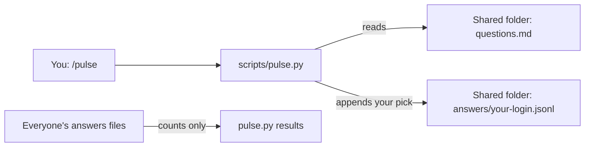

# Pulse

Your team answers one multiple-choice question a day, and everyone can see the
counts. There's no server and no connector: a folder your team already syncs
holds the questions and each person's answers.



In words: `/pulse` runs [`scripts/pulse.py`](../../scripts/pulse.py), which reads the questions from
`questions.md` in the shared folder and appends your pick to
`answers/<your login>.jsonl` beside it. `results` reads everyone's answers files
and prints counts only.

## Setting it up

One person does the first two steps for the team. Everyone does the rest on each
machine they answer from, because answering needs this harness and the folder
synced on that machine.

1. Make a folder your team syncs, such as a shared drive folder.
2. Copy [`questions.example.md`](questions.example.md) into it as `questions.md`, and edit it for your team.
3. Point this harness at the folder in your shell profile, then open a new shell:

   ```bash
   export HARNESS_PULSE_FOLDER="/path/to/the/shared/folder"
   ```

4. Add a `Pulse folder` row to `company/DATA.md`, with its `Cleared for this tool`
   cell set to `yes`. Until that row is cleared, `/pulse` stops, and standup says it
   skipped the pulse, or says nothing if there's no row. You write this row yourself;
   the harness never does.

   ```
   | Pulse folder | The team's daily question and everyone's answers | The synced folder HARNESS_PULSE_FOLDER names | yes |
   ```

5. Run `python3 scripts/pulse.py check`. It prints how many questions the bank has,
   or each problem with its question's id.

## Finding the day's question

- Say `/pulse` in a session. It shows the question and asks for your answer.
- Say `standup`. Its report names the day's question, and you say "pulse" to answer.
- In a terminal, run `python3 scripts/pulse.py question`.

Everyone holding the same bank gets the same question on the same day.

## Submitting an answer

- **In a session:** say `/pulse` and pick an option. Choose Other to answer in your
  own words. Each `/pulse` asks to run its commands, and that's expected: saying yes
  to the `answer` command is what sends your pick to the shared folder.
- **In a terminal:** the first line `question` prints has the question's id in brackets.
  Give that id and the option's number:

  ```bash
  python3 scripts/pulse.py answer energy 2
  ```

  For an answer in your own words, put them in a file and pass `--other-file`. For a
  day you missed, add `--date`:

  ```bash
  python3 scripts/pulse.py answer energy --other-file my-words.txt
  python3 scripts/pulse.py answer energy 2 --date 2026-10-30
  ```

Answer again and the last answer for that date and question counts.

## Changing the questions

Edit `questions.md` in the shared folder, then run `python3 scripts/pulse.py check`.
Other commands refuse a bank that fails it, so a mistake stops the question for the
whole team until it's fixed.

Adding, removing or reordering questions changes which question later days get,
because the day's question depends on its place in the file. Answers already given
keep the question they answered. A missed day's question comes from the current
bank, so after an edit it may differ from the one the team answered that day.

## Summarising for leadership

Say "summarise the pulse for leadership" in a session. It asks for the period, the
last 14 days unless you name another, and writes the summary to
`reports/pulse/<since>-to-<until>.md` on your machine, where git ignores it. You read
it and you send it: the harness never does. It stops if the `Pulse folder` row in
`company/DATA.md` isn't cleared.

In a terminal, this prints the same summary. Leave out `--until` for today, and
`--since` for the 14 days ending at `--until`:

```bash
python3 scripts/pulse.py summary --since 2026-10-18 --until 2026-10-31
```

Each date and question with answers gets its chip and question, how many people
answered, how many chose each option, and each Other answer. Answers stay with the
date and question they recorded, so a question you've since moved keeps them, and one
you've removed keeps them under its id.

- It counts people and never prints a login or a file name.
- A question fewer than three people answered is held back: the summary shows its
  date, its chip or id, and that fewer than three answered, with no counts and no
  Other answers.
- Other answers are quoted as written, so on a small team they can identify the person
  who wrote them, and they should never hold customer information. Read them before
  you send the summary.

## What others can see

- Your answers are in a file named after your login, and anyone with the folder can
  read them.
- `results` shows counts only, and never a name or an Other text. A question fewer
  than three people answered shows only that fewer than three answered.
- An Other answer is kept as written and can identify the person who wrote it. Never
  put customer information in one.
- A leadership summary quotes Other answers for any question three or more people
  answered, to whoever receives it.
- A login must be unique across the team and used from one machine. Two people with
  one login count as one person, and two machines syncing one file can lose answers.
